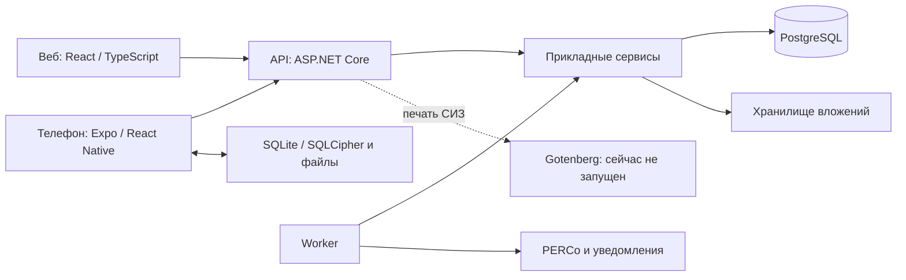

# Аудит дизайна, интерфейса и структуры проекта — 16.10.2026

## Вывод

У проекта уже есть узнаваемый светлый интерфейс ATOM: синяя основная кнопка, белые панели, таблицы, боковое меню и отдельные окна просмотра. Перерисовывать всё заново не требуется. Главные задачи — одинаковое безопасное поведение форм, более компактные рабочие экраны, сокращение слоёв CSS и согласованный выпуск текущего кода.

Подтверждены три дефекта форм: потеря добавленных точек несохранённого маршрута, отсутствие управления фокусом в окне справочника и возможность закрыть это окно во время сохранения. Отдельно выявлено расхождение рабочего окружения и исходников: 87 применённых миграций против 91 в проекте. Здоровье запущенной версии не означает, что последние исправления уже выпущены.

Это аудит, а не выпуск или реализация. Прикладной код, рабочие данные, миграции и настройки сервера не менялись. Созданы этот отчёт, диагностические тесты в игнорируемой `.tmp` и материалы проверки.

## Что и как проверено

- Текущий код web, API, worker, библиотек и мобильного клиента; дизайн-токены, стили, модальные оболочки, загрузка списков и структура EF.
- Реальный браузер: рабочая форма входа; актуальный локальный frontend на тестовых данных, без подключения к рабочему API. Размеры 1280×720 и 390×844.
- PostgreSQL и контейнеры рабочего сервера — только чтение. SQL выполнялся с `default_transaction_read_only=on` и ограничением времени запроса.
- Production-сборка web с отключённым mock-режимом, проверка типов, 426 веб-тестов, проверки структуры frontend/.NET.
- Три дополнительных компонентных теста воспроизвели существующие дефекты. Их успешный результат означает подтверждение дефекта, а не его исправление.

Не выполнялись: полный обход всех прав/модулей в авторизованном рабочем интерфейсе, реальное масштабирование браузера 200%, физический Android, полный backend regression, нагрузочные тесты, EXPLAIN рабочих запросов, печать и восстановление резервной копии. Фотография в mock-наборе — техническое изображение; качество просмотра реальных фотографий и видео по нему не оценивается.

Временный frontend на `127.0.0.1:5194` остановлен после проверки. Рабочий сервер продолжает работать независимо.

## Какой у нас дизайн

| Часть | Текущее решение |
| --- | --- |
| Назначение продукта | Производственная административная система: Обходы, учёт имущества/СИЗ, ЭМУ, PERCo, сотрудники и доступ |
| Визуальная основа | Светлый серо-голубой фон, белые панели, тёмно-синий текст, синие основные действия |
| Цвета | Основной `#1769FF`, фон `#F3F7FC`, текст `#10213F`, границы `#D8E4F2`; отдельные зелёный/янтарный/красный статусы |
| Типографика | Системный стек Segoe UI Variable Text / Segoe UI / Inter / Roboto / Arial; иконки Lucide |
| Геометрия | Токены радиусов 8/12/14 px для элементов/панелей/окон; шаги отступов 4/8/12/16/20/24 px |
| Элементы управления | Базовая высота 40 px, компактная 32 px; мобильные зоны нажатия от 44 px |
| Навигация | Левое меню модулей, верхний поиск и уведомления, вкладки внутри раздела |
| Списки | Таблицы на ПК, адаптивные карточки в части экранов, поиск, фильтры, сортировка, пагинация |
| Просмотр результатов | Список точек и детали рядом; отдельный табличный режим всех комментариев; вложения открываются в отдельном просмотрщике |
| Мобильное приложение | Родственная синяя палитра, светлая/тёмная темы, четыре основных раздела: Обход, Работы, Отчёты, Профиль |

Канонические токены: `apps/web/src/shared/styles/tokens.css`. Мобильная тема: `mobiel proekt/src/ui/atomTheme.ts`. Значения web/mobile близки, но не полностью одинаковы. Это можно согласовать через спецификацию токенов, не пытаясь использовать один CSS в React Native.

Сильные решения, которые следует сохранить: разделение названия точки и комментария, общий просмотр результата, отдельный просмотрщик вложений, понятные подписи статусов, серверная пагинация там, где она уже внедрена, и фоновая загрузка без очистки данных в обновлённых хуках.

## Проверенные шаги интерфейса

| № | Шаг | Состояние | Наблюдение и доказательство |
| --- | --- | --- | --- |
| 1 | Открытие рабочего приложения | Доступно | Сервер отвечает, показывается форма входа. Авторизация в production в этот аудит не выполнялась. [Снимок](../artifacts/design-structure-audit-2026-10-16/01-production-login.png) |
| 2 | Дашборд текущего frontend | Работает на тестовых данных | KPI, проблемные точки, план и последние результаты существуют. Нули текущей недели объясняются июньскими тестовыми записями, а не доказанной ошибкой расчёта. [Снимок](../artifacts/design-structure-audit-2026-10-16/02-dashboard.png) |
| 3 | Журнал результатов | Требует уплотнения | При 1280×720 заголовок, вкладки, сводка и фильтры занимают примерно половину окна до первой строки. [ПК](../artifacts/design-structure-audit-2026-10-16/03-results.png), [390 px](../artifacts/design-structure-audit-2026-10-16/09-results-390.png) |
| 4 | Открытие результата и комментариев | Работает, есть задача по прокрутке | Режим всех комментариев хорошо разделяет метку, текст и действия. На 390 px тело модалки и список точек имеют вложенную прокрутку; детали и фото ниже первого экрана. [Комментарии](../artifacts/design-structure-audit-2026-10-16/05-result-comments.png), [модалка 390 px](../artifacts/design-structure-audit-2026-10-16/10-result-modal-390.png) |
| 5 | Открытие вложения | Средства просмотра доступны | Есть масштаб, перемещение, список вложений, контекст точки, разворот и возврат к отчёту. Работа с реальными медиа требует отдельного прогона. [Снимок](../artifacts/design-structure-audit-2026-10-16/11-photo-viewer.png) |
| 6 | Маршруты → создание маршрута | Есть подтверждённый дефект черновика | После добавления точки Escape закрывает форму без подтверждения, повторное открытие теряет точки. Подтверждено компонентным тестом. [Форма](../artifacts/design-structure-audit-2026-10-16/07-route-create-modal.png) |
| 7 | Настройки учёта → новая запись справочника | Есть подтверждённые дефекты | Фокус остаётся на фоновой кнопке «Добавить»; нет штатного поведения Escape. Закрытие на фоне возможно во время незавершённого запроса сохранения. [Снимок](../artifacts/design-structure-audit-2026-10-16/08-settings-modal.png) |

## Дефекты и приоритеты

### P2 — потеря несохранённых точек маршрута

`apps/web/src/features/patrol/components/routes/RouteCreateModal.tsx:42` закрывает форму, проверяя только `pending`; эффект при открытии очищает `points` на строке 52. Воспроизведение: добавить точку → Escape → открыть повторно. Точки исчезают, предупреждения нет.

Исправление: определить владельца черновика; при наличии изменений применять одинаковое подтверждение для Escape, крестика, фона и кнопки отмены. Сохранение или явный отказ очищают черновик. Не нужно автоматически создавать маршрут на сервере ради закрытия формы.

Приёмка: несохранённые точки и порядок не теряются при случайном закрытии; подтверждённый отказ очищает форму; во время сохранения повторная отправка и закрытие имеют однозначное поведение.

### P2 — модалка справочника оставляет фокус на фоне

`apps/web/src/features/inventory/InventorySettingsScreen.tsx:913` содержит отдельную `SettingsModal` без общего управления фокусом. В браузере после открытия `document.activeElement` остался на «Добавить», вне диалога. Диагностический тест также подтвердил отсутствие реакции Escape.

Исправление: перевести оболочку на общую систему модалок или подключить её механизм фокуса, возврата фокуса, блокировки фоновых элементов и обработки Escape. Для изменённой формы Escape должен сначала применять политику несохранённых данных.

Не все альтернативные оболочки сломаны: `PpeModalShell` и окно пользователей имеют собственную защиту фокуса. Их нельзя механически удалить без переноса этих возможностей.

### P2 — окно можно закрыть во время сохранения справочника

В `InventorySettingsScreen.tsx:597` начинается сохранение, но `SettingsModal` получает свободный `onClose`; фон на строке 927, крестик на 932 и «Отмена» не учитывают ожидание результата. Тест с незавершённым Promise подтвердил закрытие формы до ответа.

Риск: пользователь теряет понимание результата и может повторить создание. Факт дубля в рабочей БД этим аудитом не установлен.

Исправление: единая политика `pending` для всех путей закрытия, состояние результата операции вне размонтируемой формы, понятное восстановление после ошибки или потери ответа. Для создания данных с риском повтора отдельно проверить серверную идемпотентность.

### Высокий приоритет выпуска — рабочее окружение отличается от исходников

В БД 87 миграций, в исходниках 91. В рабочей истории отсутствуют:

1. `20260622120000_InventoryStockMoveAggregationIndex`.
2. `20261008112000_MobilePushDeviceReceipts`.
3. `20261008140000_PatrolRequestDateOrderIndex`.
4. `20261011120000_InventoryOperationReceipts`.

Запущенный API использует образ с датой сборки 30.09.2026 и ревизией `e4596ee87156b4fcc46b44eca2ffe65bd5709400`. Текущий рабочий каталог содержит 545 изменённых отслеживаемых файлов и дополнительные неотслеживаемые файлы. Это не ошибка Git, но большой объём изменений требует фиксированного состава релиза и раздельной проверки модулей.

`/health/ready` возвращает 200 для установленной версии. Он не сравнивает её с локальным рабочим деревом. Не следует считать уже выпущенными свежие исправления UI, мобильной доставки и серверных сценариев только потому, что health зелёный.

Исправление: собрать проверяемый артефакт, сверить изменения схемы на копии БД, создать резервную копию, выпустить согласованные API/worker/web. Механизм манифеста уже есть в `tools/New-BuildManifest.ps1` — его следует использовать, а не разрабатывать повторно. Старую миграцию индекса stock moves проверить отдельно; не применять автоматически и не возвращать количественный складской учёт.

## Доработка модалок и списков

1. **Единая оболочка, несколько размеров.** Малые подтверждения, обычные формы и широкие просмотры используют одинаковые правила фокуса, Escape, ожидания и несохранённых изменений. Размер зависит от задачи, а не от модуля.
2. **Одна основная прокрутка.** Заголовок и действия фиксированы, прокручивается содержимое. На телефоне список точек можно сворачивать или открывать отдельно; не вкладывать длинный прокручиваемый список в длинную форму.
3. **Компактность ПК.** Сводку результатов сделать сворачиваемой и на ПК, вторичные фильтры — в раскрываемой панели. Сохранить читаемый текст комментария; уплотнять прежде всего служебные панели и отступы.
4. **Списки по общему правилу.** Поиск, сортировка, диапазон показанных строк, размер страницы, фоновые состояния, сохранение фильтров. В результатах сейчас локальная страница по 6 обходов, в других разделах встречаются 20/25 и общий выбор 25/50/100/200. Это неодинаковый интерфейс, но не основание везде принудительно поставить одно число.
5. **Фоновое обновление без сброса контекста.** Сохранять видимые строки, прокрутку и выбранную запись; показывать небольшой индикатор обновления. Общая `CompactTable` умеет заменять строки загрузкой/ошибкой, поэтому каждый потребитель должен отличать первую загрузку от фоновой. Повсеместное мерцание в этом аудите не подтверждалось.
6. **Текст и термины.** Устранить «1 комментариев», «2 точек», техническое «Права Inventory». Названия складских справочников и параметры учёта пересмотреть по действующему сценарию без удаления истории.

## CSS и производительность frontend

Измерено по текущему исходному дереву:

- 107 CSS-файлов, 81 449 строк.
- `src/styles.css` — 22 259 строк.
- 191 использование `!important`, 7 548 вхождений цветов в hex-формате.
- Корневой frontend подключает несколько последовательных слоёв базовых стилей и визуальных исправлений; учёт дополнительно содержит 22 импорта legacy/parity/redesign/polish-стилей.

Свежая production-сборка:

| CSS-часть | Размер без сжатия | gzip |
| --- | ---: | ---: |
| Основной index | 482,48 kB | 77,82 kB |
| InventoryScreen | 591,49 kB | 76,28 kB |
| ЭМУ | 267,16 kB | 42,06 kB |
| Результаты обходов | 86,78 kB | 12,48 kB |

Это измеренный объём и сложность сопровождения; время отрисовки на слабом устройстве не измерялось. Количество строк само по себе не доказывает, что код не используется.

Предлагаемый порядок: эталонные снимки состояний → перенос одного экрана на токены и локальные стили → устранение перекрывающих правил → сравнение снимков и сборки → следующий экран. Не добавлять ещё один общий файл визуальных переопределений и не удалять весь `legacy` по названию.

Дашборд загружает все страницы результатов выбранного периода для подсчёта KPI и проблемных точек (`features/dashboard/dashboardResultsLoader.ts`). Данные публикуются согласованно, есть проверки и объединение повторных загрузок. При росте истории стоит перенести агрегаты на сервер, оставив детальные списки с пагинацией. Нельзя ускорять сводку обрезанием результатов: это даст недостоверные числа.

## Структура проекта

```text
apps/
  web/                 React + TypeScript + Vite; оболочка и функциональные разделы
  api/                 ASP.NET Core API, контроллеры, авторизация и композиция
  worker/              фоновые задания и интеграции
libs/
  contracts/           DTO и внешние контракты
  application/         интерфейсы прикладных сервисов
  domain/              небольшой доменный слой
  infrastructure/      EF Core, PostgreSQL, прикладные реализации и интеграции
mobiel proekt/         Expo / React Native, локальная БД и очередь синхронизации
tests/                 .NET, контрактные, структурные и другие проверки
tools/                 сборка, выпуск, диагностика, манифесты
docs/                  архитектура, сценарии, планы и результаты проверок
artifacts/             материалы проверок и подготовленные артефакты
```



Это модульный монолит, а не набор микросервисов. Для текущего объёма нет подтверждённой необходимости дробить его на отдельные серверы. React 19, TypeScript 5.9, Vite 7; сервер — .NET 10/EF Core; мобильный клиент — Expo 56/React Native 0.85.

Что стоит структурировать:

- Крупные UI-файлы разделять по сценарию, состоянию формы, загрузке и отображению. Примеры: `EmuWorkHistoryWorkspace.tsx` 1477 строк, `MobileAccountCreateDrawer.tsx` 1204, `InventorySettingsScreen.tsx` 1014.
- Прикладные правила сейчас во многом находятся в EF-реализациях `infrastructure`; `domain` очень небольшой. Переносить повторяющиеся правила в общие прикладные компоненты постепенно. Разбиение на partial-файлы само по себе не отделяет бизнес-логику от доступа к БД.
- `contracts.ts` содержит 2331 строку. Контракты C#, web и мобильные схемы поддерживаются отдельно: нужен постоянный контроль совместимости и разделение DTO по модулям.
- Недавние исправления снимков маршрута, транзакций ЭМУ и добровольности фотографий уже присутствуют в исходниках; повторно как неисправленные они не перечисляются. Их выпуск и проверка с установленным APK — отдельная задача.
- Общая транзакционная advisory-блокировка ЭМУ защищает операции, но может ограничить параллельную работу. Сначала измерить ожидания под нагрузкой; только затем менять гранулярность, сохраняя порядок блокировок и атомарность.
- Обновить архитектурную документацию: часть описаний инфраструктуры и путей общих компонентов относится к прежней структуре. Текущий код и запущенное окружение нужно явно различать.

## База данных и сервер

| Параметр | Наблюдение 16.10.2026 |
| --- | --- |
| PostgreSQL | 17.10 |
| Размер БД | Около 61 MB |
| Таблицы | 95: `public` — 65, `inventory` — 30 |
| История миграций | 87 применено; 91 в исходниках |
| Сотрудники | 215 |
| Маршруты | 2 |
| Назначения / заявки | 116 / 116 |
| Строки результатов | 886 записей точек; это не число завершённых обходов |
| События PERCo | 16 622 |
| Журнал интеграции PERCo | 42 938 |
| Индексы/ограничения | В системных каталогах не обнаружены невалидные индексы и неподтверждённые ограничения |
| Блокировки | Ожидающих блокировок в момент чтения не обнаружено |

Основной объём занимают журнал интеграции PERCo (~17 MB) и события (~16 MB). Срочности «оптимизировать большую БД» по этим размерам нет. Нужны политика хранения диагностических логов, измерение запросов журналов и сохранение нужной истории. Удаление журналов без согласованного срока хранения не предлагается.

Для численности использованы фактические `COUNT`, поскольку оценки `n_live_tup` для ряда таблиц отличались от заполненности. Отсутствие невалидных ограничений не является полной проверкой бизнес-целостности данных.

СИЗ: `Features__PpeIssueDocuments=false`. Gotenberg не обнаружен среди работающих контейнеров, поэтому запуск нового печатного сценария остаётся задачей выпуска. Наличие схемы `inventory`, исторических движений и совместимых полей склада не означает включения проверки остатков; удалять их ради переименования интерфейса нельзя.

Redis, RabbitMQ и MinIO присутствуют в работающем окружении, хотя актуальная основная конфигурация выделяет их как необязательные. Перед отключением выяснить внешних потребителей и происхождение конфигурации. Во время аудита контейнеры не останавливались.

Мобильная БД остаётся самостоятельной частью системы: SQLite/SQLCipher, WAL, внешние ключи, последовательные транзакции, локальная очередь отправки и файлы вложений. Обновление веб-дизайна не должно менять идентификаторы операций, снимки назначений, DTO и квитанции доставки. Старое имя каталога `mobiel proekt` не переименовывать без проверки скриптов сборки.

## Предлагаемый порядок работ

1. **Безопасность форм:** исправить три подтверждённых дефекта и добавить постоянные регрессионные тесты на закрытие, фокус и сохранение.
2. **Эталон интерфейса:** закрепить токены, размеры, плотность списков, три типа окон, состояния загрузки/ошибки/пустого списка. Выбрать «Результаты» и форму справочника как первые эталонные экраны.
3. **Читаемость:** уплотнить служебные панели результатов, убрать вложенную прокрутку на телефоне, сохранить нынешнее разделение точек и комментариев; проверить реальные фото, 390 px и 200% масштаба.
4. **Структура frontend:** очищать CSS и крупные компоненты по одному модулю, с контрольными снимками и сравнением сборки. Унифицировать поведение списков, не ломая их серверные запросы.
5. **Подготовка релиза:** зафиксировать манифест и состав изменений; на копии БД проверить четыре расхождения миграций; выполнить backend/mobile acceptance, резервное копирование и отдельный согласованный выпуск.
6. **Измеряемая оптимизация:** серверные агрегаты дашборда, SQL журналов, политика хранения PERCo, ожидания блокировок ЭМУ. Приоритет уточняется по профилированию, а не только по размеру файлов.

## Материалы и воспроизведение

- [Метрики исходников](../artifacts/design-structure-audit-2026-10-16/source-metrics.json).
- [Схемы, миграции и метаданные БД](../artifacts/design-structure-audit-2026-10-16/db-schema-check.txt).
- [Production-сборка](../artifacts/design-structure-audit-2026-10-16/web-build.log).
- [426 веб-тестов](../artifacts/design-structure-audit-2026-10-16/web-tests.log).
- [Проверки структуры](../artifacts/design-structure-audit-2026-10-16/structure.log).
- [Диагностические тесты — копия для чтения](../artifacts/design-structure-audit-2026-10-16/diagnostic-probes.test.tsx), [результат](../artifacts/design-structure-audit-2026-10-16/diagnostic-probes.log).

Рабочий путь диагностических тестов: `apps/web/.tmp/design-structure-probes.test.tsx`; запуск из `apps/web`:

```powershell
node node_modules/vitest/vitest.mjs run --config .tmp/design-structure-audit.config.ts --configLoader runner
```

Тесты намеренно фиксируют неправильное поведение для аудита. При исправлении необходимо заменить ожидания на требуемое поведение и перенести сценарии в постоянный набор проверок.
