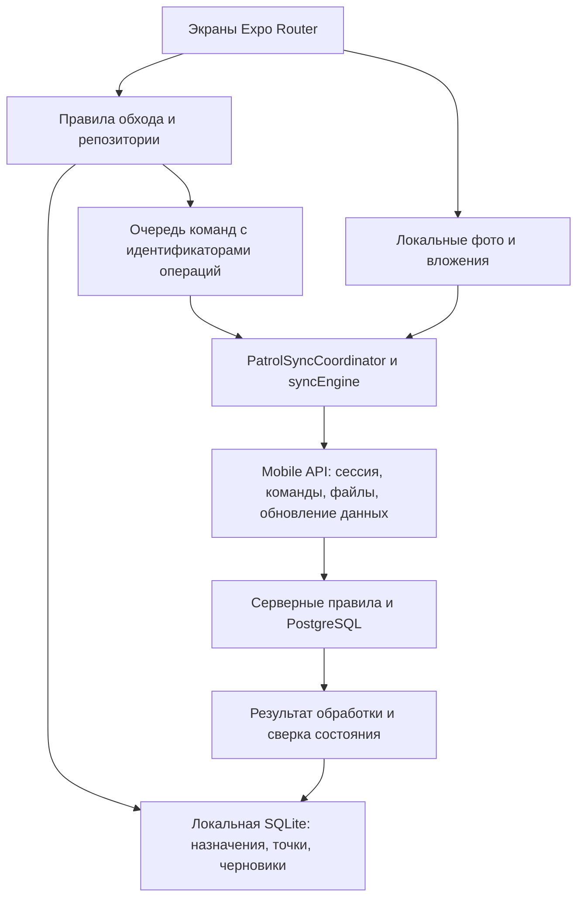

# Архитектура мобильных обходов перед изменением интерфейса

Дата: 21.09.2026. Объект: `mobiel proekt` и связанные обработчики MobileApp на сервере.

## Объём и ограничения

Изучены исходники загрузки приложения, навигации, авторизации, локального хранения, жизненного цикла обхода, NFC, заполнения точек, подготовки отчёта, очереди отправки и серверных переходов состояний. Сопоставлены согласованные макеты с фактическими возможностями. Код приложения не изменялся; существующие изменения в рабочем дереве не затрагивались.

Это архитектурная проверка и разбор UI по реализации, а не приёмка на устройстве. В рамках этой проверки не выполнены сборка APK, проверка реального NFC, замеры батареи/производительности, визуальная проверка экранов на телефоне и интеграционные испытания PostgreSQL. Красивый макет не является доказательством работы соответствующего сценария.

`npm run verify` завершился успешно: 97 тестов Node, 64 теста Vitest в 33 файлах, проверка кодировки, TypeScript и Expo lint. Лог: `audit-output/mobile-architecture-verify-2026-09-21.log`. Есть предупреждения Node о неопределённом типе модуля тестовых файлов; проверки они не остановили.

## 1. Устройство приложения

Стек по package.json: React Native 0.85.3, React 19.2.3, Expo 56, Expo Router, TypeScript, expo-sqlite, SecureStore, react-native-nfc-manager. Версия приложения в package.json — 0.1.30.

- `app/_layout.tsx`: инициализация, провайдеры темы/сессии, запуск синхронизации, обработка возврата приложения и фоновых событий.
- `src/core/bootstrap.ts`: открытие БД, восстановление прерванных переходов авторизации и отправок, обслуживание локальных данных.
- `src/auth`: токены, устройство, локальный доступ, восстановление сессии и известные блокировки.
- `src/domain/patrol`: правила состояний, заполнения и готовности отчёта.
- `src/db/repositories/patrolRepository.ts`: локальные изменения обходов и запись команд очереди; крупный модуль с несколькими ответственностями.
- `src/sync`: единый координатор, порядок команд, повторы, отправка вложений, восстановление и конфликты.
- `src/api` и `src/core`: HTTP, проверка серверов, выбор адреса и контрактов.
- `libs/infrastructure/Persistence/MobileApp`: серверная проверка команд, переходов и повторных операций.

QueryClient подключён в корне, но поиск не обнаружил useQuery/useMutation в src. Основная модель данных сейчас — SQLite, локальное состояние экранов и события синхронизации. Не следует вводить параллельный независимый кеш при редизайне.

## 2. Сущности и ответственность

| Сущность | Значение |
| --- | --- |
| Учётная запись | Авторизует доступ; может быть общей и связанной с несколькими сотрудниками |
| Устройство | Источник операций и локальной сессии |
| Сотрудник | Исполнитель/назначенный сотрудник; не равен автоматически имени аккаунта |
| Маршрут | Описание порядка точек и требований |
| Заявка на обход | Предложенная или назначенная работа |
| Назначение обхода | Конкретный принятый обход с исполнителем, состоянием и результатами |
| Результат точки | Сканирование, состояние, комментарий, вложения |
| Команда очереди | Изменение, ожидающее обработки сервером |
| Отчёт | Итог обхода, локальное завершение и доставка которого являются разными состояниями |

В интерфейсе нужно явно показывать назначенного сотрудника, а профиль общего аккаунта оформить как настройки устройства/подключения. Если фактический исполнитель может отличаться от назначенного, это должно стать отдельным явно согласованным полем, а не заменой отображаемого имени.

## 3. Несовпадения макета с текущей логикой

### Переключение маршрута — изменение правил, а не только кнопка

В `patrolRepository.ts`, `updateAssignmentLifecycleLocally`, запуск и продолжение запрещаются, если у того же owner_user_id/contour_id есть другой обход inProgress **или paused**. Проверка повторяется внутри транзакции. Поэтому последовательность «поставить A на паузу → начать B» сейчас блокируется.

На сервере `EfMobileAppService.Outbox.Patrol.RequestLifecycle.cs`:

- запуск проверяет другие inProgress/paused по EmployeeId;
- продолжение проверяет только inProgress по EmployeeId;
- клиент проверяет общий аккаунт, сервер — сотрудника.

Нужно установить единое правило допустимых параллельных/приостановленных обходов и область ограничения: сотрудник, устройство или аккаунт. Для согласованного сценария следует разрешать несколько приостановленных работ при одном активном обходе в выбранной области, если это соответствует процессу предприятия.

Также требуется надёжный переход между двумя назначениями. Очередь обеспечивает последовательность внутри одного назначения, но отдельные назначения могут чередоваться. Нельзя считать, что успешное применение A.pause всегда предшествует B.start. Решение: явная зависимость команд либо атомарная серверная операция переключения, с локальным восстановлением после прерывания и понятным конфликтом.

### Выбор исполнителя при принятии ещё не реализован

`acceptRequestLocally(requestId)` не принимает сотрудника; payload содержит заявку, маршрут, ревизию и время. Сервер для свободной заявки использует `patrolRequest.EmployeeId ?? boundEmployeeIds.First()`.

Для выпадающего выбора исполнителя нужны изменения контракта, локального снимка, команды принятия, серверной проверки и истории. Выбирать можно только разрешённых сотрудников общего аккаунта. Уже назначенного сотрудника нельзя молча заменять при принятии. Конфликт одновременного принятия на двух телефонах должен отображаться как конфликт назначения, без потери записанного на телефоне.

### «Метка недоступна» не означает созданную заявку на доступ

Текущий skipPoint записывает skipped, ручной способ подтверждения, комментарий и причину «Метка недоступна». Готовность отчёта считает ok, issue и skipped конечными состояниями. Для skipped требуется комментарий; фото зависит от требования точки. Текущая photoEvidencePolicy требует фото при requiresPhoto для issue/skipped, но не для ok.

Отдельного сценария запроса доступа в изученном наборе команд нет. Надпись «Нужно обеспечить доступ» сама по себе не создаст задачу диспетчеру. Следует разделить:

1. запрос доступа/отложенную точку, которая ещё ожидает осмотра;
2. разрешённое завершение точки как недоступной с причиной по правилам процесса.

В итогах показывать «Осмотрено» и «Недоступно» отдельно. Не выдавать количество конечных состояний за количество реально осмотренных точек.

### Отмена и передача — разные операции

Release доступен для принятого, но ещё не начатого обхода. Handoff переводит выполняемый обход в needsDispatcherDecision. Ни одна из этих операций автоматически не является запросом отмены с причиной или связью с диспетчером.

Кнопкам «Запросить отмену» и «Связаться с диспетчером» нужны определённые действия: хранение обращения и его результата либо действующий контакт/канал. Не переименовывать release/handoff без изменения семантики.

### «Завершить маршрут» можно использовать как вход в существующую проверку

Проверка готовности требует непустой маршрут и конечное состояние всех точек; дополнительно действуют требования результатов и вложений. Кнопка должна открывать сводку и список незаполненных точек, затем явное подтверждение. `queuePatrolReport` сначала локально завершает обход, затем запрашивает синхронизацию. Возврат queued не означает получение сервером.

Состояния интерфейса: «Сохранён на телефоне» → «Отправляется» → «Получен сервером». Ошибки входа, подключения и конфликт назначения требуют разных действий.

## 4. Навигация и визуальный интерфейс

Текущие вкладки: patrol, all-points, work-accounting, profile. В макете — «Обход», «Отчёты», «Профиль». Нужен отдельный список отчётов с состояниями доставки; нельзя просто заменить подпись вкладки. Доступ к существующим «Работам» и «Меткам» нужно сохранить в меню или другом согласованном месте.

Рекомендуемая структура:

- **Моя смена:** ATOM, компактная связь, назначенный сотрудник, текущая работа, следующая точка, продолжить; ниже назначенные обходы.
- **Маршруты:** поиск/фильтры, понятное принятие, состояние и сотрудник; действия текущего обхода в нижней панели.
- **Сканирование:** одна следующая точка и NFC, компактные пауза/все точки/меню; завершение доступно через управление маршрутом.
- **Точка:** сначала зелёное «Исправно», красное «Неисправно», отдельная недоступность; затем необходимые поля. Смена состояния не должна незаметно стирать введённый текст или фото.
- **Отчёт:** проверка готовности, замечания и недоступные точки, явное завершение, состояние доставки.
- **Настройки устройства:** сервер, локальные данные, очередь/диагностика, доступные функции общего аккаунта.

Подтверждённые места доработки по коду: значительные нижние отступы Screen и панели вкладок; несовпадение primaryLabel и действия signIn/serverSettings на SubmitReportScreen. Их следует исправить до визуальной приёмки. Фактическую компактность проверить на маленьком экране, с клавиатурой и увеличенным системным шрифтом; статус передавать текстом и значком вместе с цветом.

## 5. Офлайн и соединение

Сохранить существующую основу: SQLCipher/SecureStore для БД и ключа, изоляцию владельца/контура, локальные черновики, восстановление sending-команд, идентификаторы операций, серверные транзакции и защиту от дубликатов. Шифрование БД не является доказательством отдельного шифрования файлов фото.

NFC сопоставляется с локальными точками; есть защита от повторного чтения, вибрация и управление чтением при смене состояния экрана/приложения. Черновики заполнения сохраняются с задержкой и сбрасываются в хранилище при уходе/фоновых переходах. Эти механизмы нельзя потерять при разделении экранов.

Подтверждённые по коду направления улучшения подключения:

1. Общее состояние связи вместо проверки health каждым экземпляром Screen. Обычный API уже имеет кеш health, но экранный путь его обходит.
2. Разделить «Проверить введённый адрес» и поиск резервного сервера: сейчас сохранённый адрес может проверяться раньше указанного пользователем. Показывать фактически проверенный адрес; не менять настройку побочным эффектом индикатора связи.
3. Ограничить суммарное ожидание выбора сервера: последовательные тайм-ауты кандидатов суммируются. Сохранять проверку принадлежности одному контуру.
4. Добавить случайный разброс повторов, чтобы телефоны не отправляли всё одновременно после восстановления связи.
5. Показывать готовность к офлайн-работе до начала: снимок маршрута, метки, требования, локальная сессия и место для вложений.

Фоновая отправка уже предусмотрена через expo-background-task; это не гарантия мгновенной доставки при закрытом приложении. Не добавлять второй независимый обработчик очереди. Поведение после остановки процесса и ограничений Android проверить на целевом устройстве.

## 6. Оптимизация: сначала измерения

Полное bootstrap-обновление без курсора — кандидат на версии/дельту после измерения объёма и частоты. Очистка при запуске и открытие отдельного защищённого соединения для транзакций — кандидаты на профилирование, а не доказанные причины торможения. Фото уже уменьшаются; хеширование файлов уже потоковое. Для крупных видео можно отдельно оценить возобновляемую загрузку.

Измерять: холодный запуск, время локального сохранения точки, задержку NFC до открытия формы, время получения подтверждения отчёта, возраст очереди, объём обновлений/вложений, память и батарею за смену. Повторить одинаковый маршрут до и после изменений.

Крупный patrolRepository целесообразно постепенно разделить на принятие/жизненный цикл, результаты точек и завершение. Сначала зафиксировать поведение тестами; не совмещать большой рефакторинг с новой логикой переключения и всем редизайном.

## 7. Последовательность внедрения

1. Зафиксировать единые правила исполнителя, паузы/переключения, недоступной точки и отмены. Обновить контракты и тесты клиента/сервера.
2. Исправить связь и точную проверку адреса, согласовать подписи действий, сохранить существующую очередь и гарантии локального сохранения.
3. Внедрить ATOM UI по экранным сценариям: главная → маршруты → NFC → состояние/форма → завершение/отчёты. Сохранить доступ к работам и меткам.
4. Выполнить сквозную проверку на изолированном сервере и реальном телефоне; затем измерить и точечно оптимизировать.

Обязательные сценарии приёмки: принятие свободного/назначенного обхода общим аккаунтом; запрет постороннего исполнителя; конкурирующее принятие с двух устройств; пауза A/старт B/возврат A; прерывание переключения; полный обход без сети после загрузки; перезапуск на заполнении; повторная/чужая NFC-метка; недоступная точка с причиной; незаполненные обязательные данные; потеря ответа после принятия отчёта сервером; обрыв вложения; истечение токена; отмена сервером; недостаток места; восстановление LAN без Интернета; смена сети и ограничения фоновой работы.

Условие готовности: сохранённые локально результаты не теряются, повтор отправки не создаёт дублей, назначение исполнителя проверяется сервером, интерфейс не показывает доставку до подтверждения, незавершённые точки не обходят проверку, все согласованные действия доступны и понятны на телефоне.

## Основные исходники для продолжения

- `mobiel proekt/app/_layout.tsx`, `app/(tabs)/_layout.tsx`
- `mobiel proekt/src/core/bootstrap.ts`, `src/core/serverCandidatePolicy.ts`
- `mobiel proekt/src/db/database.ts`, `src/db/encryptedDatabase.ts`, `src/db/repositories/patrolRepository.ts`
- `mobiel proekt/src/domain/patrol/patrolStateMachine.ts`, `reportReadinessPolicy.ts`, `photoEvidencePolicy.ts`
- `mobiel proekt/src/sync/PatrolSyncCoordinator.ts`, `syncEngine.ts`, `outboxOrderingPolicy.ts`
- `libs/infrastructure/Persistence/MobileApp/EfMobileAppService.Outbox.Patrol.cs`
- `libs/infrastructure/Persistence/MobileApp/EfMobileAppService.Outbox.Patrol.RequestLifecycle.cs`
- Предыдущий разбор подключения и UX: `docs/mobile-review-2026-09-20.md`.
